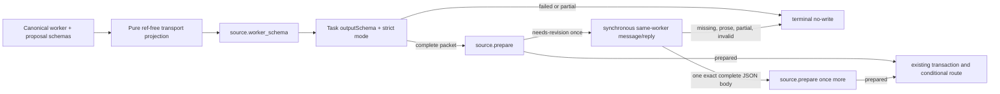

# Swarm source recovery

**Datetime**: 2026-08-02-1452
**Scope**: Atlas source-worker transport, correction handoff, and one authorized `swarm` ingestion
**Summary**: Replace prompt-only initial worker delivery with a canonical, Task-compatible structured-output projection; consume the same worker's synchronous correction reply as the complete replacement packet; then run the existing Atlas workflow until `swarm` is durably active and current.
**Status**: DONE

## Context

The literal goal is to make `source swarm` succeed, not move the failure to another validator. Diagnosis is complete:

- `source.inventory` correctly classified `swarm` as new. `source.lookup` still returns `row:null` at MANIFEST revision `sha256:613de51a7c9862648623067dd55134a95b441e79d37f716e86a8a318fb40ccac`.
- The latest `DraftTerminalSwarm` task was dispatched without `outputSchema` or `schemaMode`. Prompt text demanded the full packet, but the worker returned a partial `kind:"ready"` object with a corrupt evidence key and without `evidence_ledger`, `proposal`, `checklist`, or `refresh_after`.
- Atlas did not cause or accept that corruption. The invocation stopped before `source.prepare`, transaction, route, or any vault write.
- Live, zero-Atlas-effect Task probes established the actual schema dialect:
  - the canonical worker schema fails because Task cannot resolve sibling `source-summary-proposal.schema.json`;
  - embedding that schema without rewriting its refs fails on `#/$defs/metadata`;
  - flattening refs still fails on the checklist's `allOf` refinement;
  - a deterministic, ref-free projection with concrete positional checklist items accepts complete `ready` and `no-write` packets;
  - it preserves a legal extra `evidence_bundle` field;
  - it rejects the recorded partial-ready shape with `evidence_ledger: is required`.
- The prior correction failure was coordinator-side, not missing worker data. `hub.send(..., await:true)` returned the same worker's complete corrected packet in its synchronous reply, but the workflow then reread the worker's earlier terminal artifact and incorrectly required a second publish/yield. OMP corrections are direct replies; the direct reply is the correction result.

Diagnosis evidence is revision-bound to:

- `/Users/kim/.omp/reports/omp-report-2026-08-02T07-36-06-161Z/raw-sse.txt` — SHA-256 `1d8a00d3744cac645a8f1cd84a7ab29707d41399c9be2fb61c1a059e15d55676`
- `/Users/kim/.omp/reports/omp-report-2026-08-02T07-36-06-161Z/session.jsonl` — SHA-256 `981322d8205efde436a7ec716e4397538183dd58dd16a25c6ce1716b5c1714f9`

## Route Overview

Goal: Make Atlas source-worker delivery structurally reliable and ingest the `swarm` source successfully.
Route: completed `dev-diagnosing-bugs` → `dev-implementation` → `atlas-source` execution loop → `dev-verification` → `dev-code-review` → `dev-continual-learning` → completion presentation
Why: Expected behavior, source identity, and transport failure are now settled. One cohesive implementation can add the missing transport gate without changing source semantics. Standard assurance is appropriate because the generic source workflow and one development-instance source transaction change.
Artifacts: A pure transport-schema projection and façade operation; architecture/contract/skill updates; focused regressions and no-effect Task smoke; one durable `swarm` source plus normal route effects when required; independent verification and review reports.
Gates: Approval of this exact plan authorizes only the normal bound-development-instance writes required to source and, if requested by the prepared receipt, route `swarm`. Credential use, profile switching, non-development writes, destructive repair, migration, deployment, packet reconstruction, or harness/runtime modification require a revised route.
Execution: one cohesive implementation owner; one dedicated source worker for the ingestion attempt; one independent verifier; one distinct reviewer; assurance: standard
First action: Record the transport invariant and exact façade contract in the canonical architecture and reducer contract.

## Target identity

Rebind all hashes immediately before implementation; any drift requires inspection and plan revision rather than overwrite.

- `.agents/ARCHITECTURE.md` — `3eb5e6a4e7fdb195aeba2da3d50623c0bc4ef06536b2ec2880db232d2c95a82b`
- `.agents/AGENTS.md` — `3abbc08a02914a9e36564120f73dd9442b039db8abb9812a83c8c36ca809f19d`
- `.agents/skills/atlas-core/assets/markdown-registry-contracts.md` — `f21fb7eaf974d94d403587f7f3959fbd167aba34590d56fe7eb2a975b151376a`
- `.agents/skills/atlas-core/assets/source-worker-result.schema.json` — `fec5397db2d857735dd704e7f65eef59cac4aa051ead11e8d0292e8bd7d5518e`
- `.agents/skills/atlas-core/assets/source-summary-proposal.schema.json` — `a52b340a1affd4d572dd914b8e0be604152a1fdaf9b7044890f9c15b0edb0a3f`
- `.agents/skills/atlas-source/SKILL.md` — `9e14517b020d2723dbbbb93b6db5062a17ec3c486e6259b2b8472f0cfe05ae72`
- `scripts/atlas_source.py` — `39f6bbe5853885c9331df566337c367c144cafd8eb6e0eed6ac3ea1ccee46a2d`
- `scripts/atlas_tool.py` — `c763ae8b0143ebb60db60e6b379c609bed54e498aaa18a85ef618ee1648c81b5`
- `tests/test_atlas_tool.py` — `ba40e6893d0fe381ab2378d737f906009e99a22b204385c5f5d5c5bd8913830a`
- `tests/test_atlas_harness_surface.py` — `742d4b7e75986048e2ef4f1efaccf84de8b27c2cc1267a793961a5a4d8723ec5`

Canonical source identity:

- URL: `https://github.com/cursor/plugins/blob/main/pstack/skills/swarm/SKILL.md`
- Source ID: `c836a9a1d3a3`
- Intended profile: injected local profile resolving to instance `atlas`; verify it is still the active development profile before effects.

## Design

### Transport projection

Add a pure `project_worker_transport_schema(worker_schema, proposal_schema)`-style transform in `scripts/atlas_source.py`. The fixed-path loader and exact-args `{}` operation `source.worker_schema` live in `scripts/atlas_tool.py`, which passes decoded canonical assets into the pure transform.

The projection MUST:

1. Accept decoded deep copies of `source-worker-result.schema.json` and `source-summary-proposal.schema.json`; the façade alone loads those fixed product-owned paths.
2. Never mutate its inputs or copy-maintain a second authoritative schema.
3. Resolve every local worker ref, the one sibling proposal ref, and every proposal-local ref into one finite schema object.
4. Replace the canonical checklist tuple's seven `allOf` refinements with seven concrete positional item schemas derived from the canonical `checklist_item` plus each canonical ID.
5. Remove now-unused `$defs`, `$id`, and embedded resource markers only from the returned projection.
6. Reject unexpected external refs, residual refs, residual `allOf`, unsupported cycles, or canonical-shape drift with one stable façade failure; never silently relax a constraint.
7. Preserve every canonical constraint supported by the proven transport dialect, including the four terminal variants, exact fields, patterns, consts, tuple order, and `evidence_bundle.additionalProperties:true`.

The façade returns only `{"schema": <projection>}`. This is generation-time transport guidance, not a validator. `source.prepare`, `validate_worker_result`, evidence validation, checklist validation, proposal/ledger tuple binding, rendering, and transaction construction remain authoritative and unchanged.

### Initial worker delivery

Update `.agents/ARCHITECTURE.md`, `markdown-registry-contracts.md`, `.agents/skills/atlas-source/SKILL.md`, and the `.agents/AGENTS.md` operation map in canonical order:

1. After the single inventory call, call `source.worker_schema` once for the worker wave.
2. Bind decoded `result.schema` to every initial worker dispatch through the active harness's native strict structured-output fields. For the current OMP Task tool, the concrete item fields are `outputSchema:<schema>` and `schemaMode:"strict"`; product workflow prose remains provider- and harness-neutral.
3. Keep one Task batch for independent actionable sources; do not serialize workers.
4. Consume only a completed, schema-accepted worker output object. A failed task, missing object, invalid JSON, or permissive/fallback result is terminal `rejected`/no-write for that source and does not consume the semantic correction allowance.
5. Pass the complete object unchanged to `source.prepare`; retain all current semantic and current-state checks.

### One correction handoff

The correction is not a second Task and therefore does not inherit the initial Task's native schema binding. Make the existing same-worker receive path explicit:

1. On the first `needs-revision`, use the active harness's synchronous same-worker message/reply operation with the exact normalized findings and the existing instruction to return one complete wholesale `kind:"ready"` JSON object. In the current OMP execution this is one `hub.send(..., await:true)`.
2. Treat the returned reply body as the sole correction result. Parse the entire body as one JSON object without code-fence extraction, field merging, delta application, prose stripping, or reconstruction.
3. Do not reread the worker's stale initial result artifact and do not require another yield, publish step, or acknowledgement.
4. Pass the parsed object unchanged to `source.prepare` exactly once more. Its existing strict and semantic validators own acceptance.
5. Missing, timed-out, non-JSON, prose-wrapped, partial, non-`ready`, still-invalid, or second-correction output is terminal no-write/rejected.

This keeps correction bounded at one semantic retry while removing the false second-publication requirement observed in the supplied trace.

## Tasks

- [x] T1. Update architecture, registry contract, and source skill for strict initial output and synchronous same-worker correction consumption.
- [x] T2. Implement the deterministic Task-compatible worker-schema projection and `source.worker_schema` façade operation.
- [x] T3. Add focused projection, façade, skill-surface, correction, and preserved-validator regressions.
- [x] T4. Run zero-Atlas-effect generated-schema smoke for valid ready, valid no-write, legal evidence extension, and malformed ready rejection.
- [x] T5. Run `atlas-source` for `swarm`, execute only its prepared source transaction and required route handoff, and verify active/current presence.
- [x] T6. Diagnose and repair only any novel product-owned blocker within this same transport/source boundary, then repeat T3–T5; stop on identical or out-of-scope failure.
- [x] T7. Independently verify the immutable product target and bound source state; run one final review and one terminal learning assessment.
- [x] T8. Present exact changes, effects, checks, source identity/revision, and residual risk.

## Ordered implementation details

### T1 — Canonical contract and workflow

- Architecture records the invariant: source workers cross native strict structured-output transport under a canonical-derived schema; transport success never replaces preparation validation.
- The registry contract specifies the exact façade input/output, projection ownership, strict initial worker binding, and direct same-worker correction reply.
- The skill names the generic native strict-output requirement and synchronous correction receive path. It may name the concrete Task fields as an execution mapping, but must not add provider/model branches. Keep the command stub thin and unchanged.
- Delete the false requirement that corrected data must appear as a new terminal artifact or separate publish operation.

### T2 — Projection and façade

- Add the pure transform under `atlas_source.py`; add fixed product-asset paths and JSON loading under `atlas_tool.py`. Keep filesystem/profile/connector concerns out of the transform.
- Add `source.worker_schema` to `atlas_tool.OPERATIONS`, capability output, `_pure` dispatch, `.agents/AGENTS.md`, and the documented façade operation family.
- The operation accepts no caller-selected path, schema, or branch. Callers cannot substitute a weaker contract.
- Missing, malformed, cyclic, unexpectedly shaped, or non-projectable assets fail as `WORKER_SCHEMA_INVALID` at `assets`; do not fall back to the unprojected schema.

### T3 — Permanent regressions

Extend existing seams rather than create a parallel suite:

- `tests/test_atlas_tool.py`
  - capability list and exact `{}` request;
  - deterministic projection with no `$ref`, external resource, `$defs`, or `allOf`;
  - all four canonical terminal branches remain represented;
  - complete ready/no-write and legal evidence-extension fixtures remain valid at the transport shape;
  - the recorded partial-ready shape is structurally impossible;
  - canonical asset objects are unchanged after generation;
  - unsupported/cyclic/drifted schema inputs fail closed;
  - existing date fallback, invalid present dates, ledger/proposal findings, evidence validation, correction exhaustion, and no-write/no-mutation tests remain unchanged and passing.
- `tests/test_atlas_harness_surface.py`
  - source skill requires `source.worker_schema` and native strict schema binding before initial dispatch;
  - correction uses one synchronous same-worker reply and forbids stale-artifact reread/reconstruction;
  - no provider-specific harness wording is introduced.

### T4 — No-effect smoke

Use the schema returned by the new façade operation, not a hand-built test object. In one read-only Task batch:

1. Return a complete minimal `no-write`.
2. Return a complete static `ready` with one legal extra evidence field.
3. Attempt the recorded partial `ready` without permitting substitution.

Acceptance: the first two complete unchanged, the evidence extension survives, and the third terminates with schema validation rather than a completed partial packet. No Atlas façade call other than pure `source.worker_schema`; no fetch, inventory, prepare, connector, vault, transaction, or route effect.

### T5 — Authorized ingestion and direct effect verification

1. Reconfirm the active profile is the intended local development instance and `source.lookup` still reports the canonical URL absent or already current.
2. If already current because of an external concurrent run, do not duplicate effects; verify the existing row/artifact and continue to T7.
3. Otherwise run the public `atlas-source` workflow for `swarm`: one inventory, one strict initial worker, one `source.prepare`, at most one direct same-worker correction and second prepare, then the unchanged prepared transaction.
4. Invoke `atlas-route` only if the applied/no-op source receipt says `route_required:true`; preserve its separate transaction/recovery owner.
5. Verify with fresh `source.lookup` and `source.inventory` that canonical URL/source ID are active and current at the committed revision. Read the resulting source artifact through the façade only as needed to confirm identity; do not hand-edit it.
6. Remove every temporary smoke fixture or local packet capture before assurance.

### T6 — Bounded iteration

Iteration is driven by novel evidence, never a blind retry count:

- A source-quality `needs-revision` uses only the existing single correction path.
- A new, reproducible product-owned failure inside the approved worker transport, preparation, source transaction, or required route handoff gets a minimized no-effect reproduction, the smallest owner-level fix, focused regression, and a repeat of T3–T5.
- The same failure on the same immutable product target after its focused smoke ends `BLOCKED`; do not add retries, packet salvage, persistence, or fallback parsing.
- Credential, connector/profile, migration, destructive repair, provider-runtime modification, general Task/hub redesign, or materially broader architecture findings stop before writes and require route reapproval.

### T7 — Efficient assurance

- Implementation owner: run the focused test cases and direct generated-schema smoke once after the cohesive change. Do not run verifier/reviewer loops during intermediate edits.
- Independent verifier: bind final file hashes and source MANIFEST/artifact revisions; run
  - `python3 -m unittest tests.test_atlas_harness_surface tests.test_atlas_tool tests.test_atlas_quality`
  - `python3 scripts/atlas-instance.py check`
  - fresh pure schema operation and source lookup/inventory observations.
- Distinct reviewer: review only the verifier-bound immutable target against repository standards, this plan, and preserved fail-closed semantics. No repair during review.
- Run one terminal continual-learning assessment after verified review. Curate only a proven reusable gap not already captured in architecture/contracts/skill; do not add duplicate rules.

## Verification / done criteria

- [x] The initial Task carries the generated canonical-derived schema and strict mode; the recorded partial packet cannot complete successfully.
- [x] Valid `ready` and `no-write` packets traverse unchanged, including legal evidence metadata.
- [x] No second authoritative schema or semantic validator exists; canonical assets and current preparation/quality owners remain unchanged.
- [x] The same worker's one synchronous correction reply is consumed directly and wholly; no stale artifact, delta, prose, or reconstruction path remains.
- [x] Missing/wrong/null evidence core, invalid dates, malformed ledger/proposal, bad projections/media, failed checklist, invalid correction, and exhausted correction remain fail-closed with no transaction.
- [x] `source.lookup` and `source.inventory` observe `https://github.com/cursor/plugins/blob/main/pstack/skills/swarm/SKILL.md` / `c836a9a1d3a3` as active and current at the final committed revision.
- [x] Any required route handoff completed through its existing separate owner; no duplicate source or relation was created.
- [x] No temporary source, route, transaction, worker-packet, or verification fixture remains.
- [x] Independent verification returns VERIFIED; final review returns Standards PASS, Specification PASS, and Overall APPROVED; `atlas-instance.py check` passes.

## Non-goals

- No weakening or source-specific branching in the canonical worker/proposal schemas.
- No coordinator packet repair, tolerant parser, code-fence extraction, field merge, semantic fallback, or invented evidence.
- No extra semantic retry, blind model retry, worker packet persistence, batch recovery protocol, or orchestration redesign.
- No changes to evidence-date fallback, proposal/ledger binding, evidence projection/hash/media checks, transaction mechanics, connector/profile behavior, or route ownership unless a novel reproduced blocker proves one is the actual owner and remains within T6's gate.
- No deployment, migration, credentials, non-development profile writes, or destructive registry repair.

## Completion Summary

- Added the deterministic canonical-derived, Task-compatible worker-schema projection and pure `source.worker_schema` façade; initial source workers now use native strict structured output.
- Corrected the one-revision handoff contract so the same worker's synchronous complete JSON reply is consumed directly as the sole replacement packet; stale result artifacts, reconstruction, retries, persistence, and fallbacks remain forbidden.
- Preserved acquisition-date fallback, present-invalid date rejection, proposal/ledger binding, evidence/checklist validation, canonical schema authority, and terminal no-write behavior.
- Ingested and routed `swarm` as active source `c836a9a1d3a3`, sequence `633`, content hash `9acc699c0478dc62618f2e45fb4b902f434b079b23c50cc3756689e8187d392d`; created two pending route edges through the existing route owner.
- Independent verification: `VERIFIED`; focused suite passed twice with 80 tests each, native strict Task probes accepted valid terminal output and rejected incomplete `ready`, state validation and instance check passed.
- Final review: Standards `PASS`, Specification `PASS`, Overall `APPROVED`, no blocking findings or advisories. Terminal assessment: `NO DURABLE LEARNING`; the reusable corrections were already captured in canonical product guidance.
- Preserved the concurrent unrelated `.agents/AGENTS.md` `memory/` layout entry by rebinding and rerunning assurance. Topic refresh remains a separate normal workflow because both routed edges are intentionally pending.