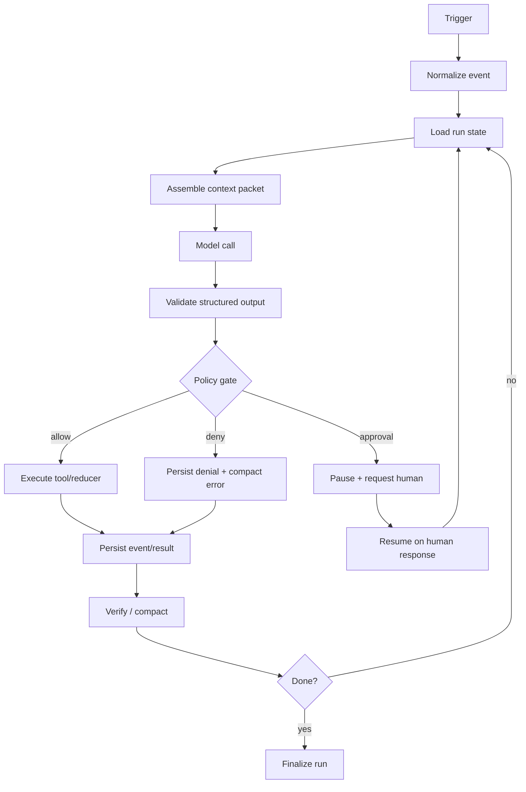

# Agentic Harness Architecture Research Handoff

## Purpose

Continue research on **agentic harness architecture**: how to engineer the runtime, context, tools, skills, hooks, state, verification, and orchestration around LLM agents so they become more reliable, maintainable, debuggable, and scalable.

This handoff is exclusively about **agent harness design**. It intentionally avoids any project-specific research-vault or domain framework details.

---

## Primary thesis

The strongest through-line across the references:

> Reliable agents are not “a prompt plus tools in a loop.” They are mostly deterministic software systems with carefully placed LLM calls, structured interfaces, explicit state transitions, bounded context, and verification/back-pressure.

The model should handle the parts that benefit from language/reasoning/flexibility. The harness should own:

- context selection;
- tool/action interfaces;
- control flow;
- state transitions;
- pause/resume;
- guardrails;
- verification;
- back-pressure;
- durable logging;
- delegation boundaries;
- human approval points.

---

## Source packet

### Primary basis

1. **12-Factor Agents — HumanLayer / Dex Horthy**
   - Main index: <https://github.com/humanlayer/12-factor-agents>
   - Core claim: production-quality agents are small LLM-powered steps inside deterministic software, not opaque framework loops.
   - Most important factors for harness research:
     - [Factor 1: Natural Language to Tool Calls](https://github.com/humanlayer/12-factor-agents/blob/main/content/factor-01-natural-language-to-tool-calls.md)
     - [Factor 3: Own your context window](https://github.com/humanlayer/12-factor-agents/blob/main/content/factor-03-own-your-context-window.md)
     - [Factor 4: Tools are just structured outputs](https://github.com/humanlayer/12-factor-agents/blob/main/content/factor-04-tools-are-structured-outputs.md)
     - [Factor 5: Unify execution state and business state](https://github.com/humanlayer/12-factor-agents/blob/main/content/factor-05-unify-execution-state.md)
     - [Factor 6: Launch/Pause/Resume with simple APIs](https://github.com/humanlayer/12-factor-agents/blob/main/content/factor-06-launch-pause-resume.md)
     - [Factor 8: Own your control flow](https://github.com/humanlayer/12-factor-agents/blob/main/content/factor-08-own-your-control-flow.md)
     - [Factor 10: Small, Focused Agents](https://github.com/humanlayer/12-factor-agents/blob/main/content/factor-10-small-focused-agents.md)
     - [Factor 11: Trigger from anywhere](https://github.com/humanlayer/12-factor-agents/blob/main/content/factor-11-trigger-from-anywhere.md)
     - [Factor 12: Make your agent a stateless reducer](https://github.com/humanlayer/12-factor-agents/blob/main/content/factor-12-stateless-reducer.md)

### Supporting references

2. **Anthropic — Building Effective Agents**
   - <https://www.anthropic.com/engineering/building-effective-agents>
   - Key claims:
     - Start simple.
     - Prefer simple composable workflows over heavy frameworks.
     - Add complexity only when it measurably improves outcomes.
     - Distinguish workflows from agents:
       - workflows = predefined code paths with LLM/tool calls;
       - agents = LLMs dynamically direct their process/tool use.
     - Tool design and documentation are part of the agent-computer interface.

3. **HumanLayer — Skill Issue: Harness Engineering for Coding Agents**
   - <https://www.humanlayer.dev/blog/skill-issue-harness-engineering-for-coding-agents>
   - Key claims:
     - Agent quality is often a harness/configuration problem, not just a model problem.
     - Harness = model plus runtime/configuration surface.
     - Levers:
       - context files;
       - tools/MCP;
       - skills;
       - sub-agents;
       - hooks/plugins;
       - back-pressure;
       - verification.
     - Sub-agents act as context firewalls.
     - Hooks are for deterministic control flow and feedback, not heavy reasoning.
     - Success should usually be silent; failures should surface compactly.

4. **LangChain — Context Engineering in Agents**
   - <https://docs.langchain.com/oss/python/langchain/context-engineering>
   - Key claims:
     - Agent reliability usually fails because the wrong context was supplied.
     - Context engineering = providing the right information/tools in the right format.
     - Useful distinction:
       - model context = transient inputs to one model call;
       - tool context = what tools can access/write;
       - lifecycle context = middleware/hooks between model/tool calls;
       - runtime context = static config;
       - state = conversation-scoped memory;
       - store = cross-conversation memory.

---

## Core architecture model

### Harness as deterministic runtime

A useful mental model:

```text
external trigger
  -> deterministic orchestrator
  -> selected context
  -> bounded LLM call
  -> structured output
  -> deterministic reducer/tool execution
  -> persisted state/event/result
  -> verification/back-pressure
  -> continue | pause | finish | ask human
```

The harness should be responsible for deciding:

- what the model sees;
- what actions are allowed;
- which action schemas exist;
- how actions are applied;
- what state is persisted;
- when to stop;
- when to ask a human;
- when to spawn sub-agents;
- when to compress or discard context;
- how to verify output.

The LLM should not be the sole owner of control flow.

---

## 12-Factor interpretation for agent harnesses

### Factor 1 — Natural language to tool calls

Harness implication:

- The LLM translates fuzzy intent into structured payloads.
- Deterministic code executes the payload.
- The key interface is not “model text”; it is a schema the harness can validate.

Example pattern:

```json
{
  "intent": "route_request",
  "category": "billing",
  "confidence": "high",
  "reason": "User asks about failed invoice payment"
}
```

Then deterministic code routes to the billing workflow.

Design rule:

> Prefer typed/validated structured outputs over prose instructions when the result affects control flow or state.

---

### Factor 2 — Own your prompts

Harness implication:

- Prompts are part of the codebase.
- Prompts should be versioned, reviewed, tested, and scoped.
- Avoid generic mega-prompts.
- Separate:
  - base identity;
  - task instructions;
  - tool-use protocol;
  - output schema;
  - safety/approval rules;
  - examples.

Design rule:

> Treat prompt files as source code with tests/evals, not as incidental config.

---

### Factor 3 — Own your context window

Harness implication:

- Context is the primary interface to the model.
- Do not dump everything into context.
- Build compact, task-specific context packets.
- Separate durable state from transient model context.
- Use progressive disclosure:
  - root instructions;
  - selected skills;
  - specific docs;
  - relevant tool results;
  - summarized history.

Design rule:

> The harness should assemble context intentionally; the agent should not browse blindly through all available state.

---

### Factor 4 — Tools are structured outputs

Harness implication:

- “Tool call” does not require framework magic.
- It can be modeled as:
  1. model emits JSON;
  2. harness validates JSON;
  3. harness runs deterministic code;
  4. harness appends result/event.

Design rule:

> A tool is a structured intent plus deterministic handler. The handler, not the model, owns side effects.

---

### Factor 5 — Unify execution state and business state

Harness implication:

Avoid duplicating state across:

- workflow status tables;
- hidden queues;
- chat transcripts;
- tool logs;
- app records;
- agent scratchpads.

Instead, make the durable event/state record sufficient to infer workflow state.

Example:

```text
request_received
tool_intent_created
tool_result_received
approval_requested
approval_granted
action_applied
verification_failed
fix_applied
done
```

Design rule:

> If possible, derive “where the agent is” from durable events instead of keeping a second hidden execution-state machine.

---

### Factor 6 — Launch / pause / resume with simple APIs

Harness implication:

Agents need normal program lifecycle primitives:

```text
launch(input) -> run_id
status(run_id) -> status
resume(run_id, event) -> status
cancel(run_id) -> status
```

Pause/resume matters especially at:

- human approval gates;
- long-running jobs;
- external waits;
- rate limits;
- high-risk actions;
- tool-selection-before-tool-execution moments.

Design rule:

> The harness should support durable pause before high-impact execution, not just after action completion.

---

### Factor 7 — Contact humans with tools

Harness implication:

Human-in-the-loop is not a side channel. It should be a first-class tool/event.

Example event:

```json
{
  "intent": "request_human_approval",
  "action": "deploy_backend",
  "risk": "production change",
  "summary": "Deploy tag v1.2.3 to production",
  "approval_options": ["approve", "reject", "modify"]
}
```

Design rule:

> Human approval should be typed, resumable, auditable, and represented in the same event/state model as tool calls.

---

### Factor 8 — Own your control flow

Harness implication:

The most important architectural decision: do not hide the loop.

Own:

- branching;
- retries;
- error compaction;
- approval breaks;
- model selection;
- tool execution;
- sub-agent delegation;
- termination;
- verification;
- pause/resume.

Avoid:

```text
while not done:
  model decides everything
  tools execute blindly
```

Prefer:

```text
while true:
  next = model_or_policy(state)

  switch next.intent:
    case "safe_tool":
      execute
      continue

    case "high_risk_tool":
      persist approval request
      pause

    case "needs_subagent":
      launch subagent
      continue when result returns

    case "done":
      verify
      return
```

Design rule:

> The harness owns the loop. The LLM proposes steps; the runtime decides what happens.

---

### Factor 9 — Compact errors into context

Harness implication:

Errors are useful, but raw logs poison context.

Good error handling:

```text
command failed:
  check: typecheck
  files:
    - src/foo.ts
  root cause:
    Missing required field `id`
  next action:
    Update callsite to pass id
```

Bad error handling:

```text
4,000 lines of build/test output
```

Design rule:

> Failure should be compact, structured, and actionable. Success should usually be silent.

---

### Factor 10 — Small focused agents

Harness implication:

Use sub-agents to isolate context and specialize work.

Good sub-agent tasks:

- locate definitions;
- inspect patterns;
- research a library;
- review one subsystem;
- execute a bounded refactor;
- run a verification pass;
- summarize logs.

Bad sub-agent tasks:

- “be the backend engineer” with broad open-ended scope;
- duplicate parent orchestration;
- multi-hour ambiguous autonomy;
- tasks with unclear output contract.

Design rule:

> Sub-agents are context firewalls and bounded workers, not vague personas.

---

### Factor 11 — Trigger from anywhere

Harness implication:

Agent workflows should be launchable from multiple sources:

- chat;
- CLI;
- cron;
- webhook;
- issue tracker;
- editor;
- monitoring alert;
- another agent.

But every trigger should normalize into the same internal event format.

Example:

```json
{
  "trigger": "github_issue",
  "source": "repo/issues/123",
  "intent": "plan_fix",
  "payload": {
    "title": "...",
    "body": "..."
  }
}
```

Design rule:

> Many triggers, one internal event interface.

---

### Factor 12 — Stateless reducer

Harness implication:

An agent step can be modeled as:

```text
(state, event) -> new_state + effects
```

Useful reducer framing:

```text
current durable state
+ new trigger/tool result/human response
+ selected context
+ model decision
-> validated action
-> persisted event/result
-> next state
```

Design rule:

> Make every workflow step replayable, inspectable, and resumable from durable state.

---

## Harness components taxonomy

### 1. Agentfiles / context files

Examples:

- `AGENTS.md`
- `CLAUDE.md`
- repo-specific rules
- system prompts
- scoped instructions

Use for:

- durable universal constraints;
- repo conventions;
- safety rules;
- workflow defaults;
- command usage examples.

Avoid:

- huge directory maps;
- stale overviews;
- excessive conditional rules;
- generic “be careful” prose;
- instructions the harness can enforce deterministically.

Key reference:
- HumanLayer article cites evidence that agentfiles can hurt if too long, auto-generated, or irrelevant.

Design heuristic:

```text
Context file content should be:
  durable
  concise
  globally applicable
  hard for the model to infer from tools
```

---

### 2. Tools

Tools are the model’s action surface.

Good tool properties:

- clear name;
- narrow responsibility;
- validated schema;
- explicit failure modes;
- examples;
- safe defaults;
- compact results;
- stable semantics;
- structured output where possible.

Bad tool properties:

- broad generic shell-like mutation;
- overlapping tools;
- too many tools;
- verbose success output;
- hidden side effects;
- unclear path/permission behavior.

Anthropic’s ACI framing matters:

> Tool design is agent-computer interface design. Invest in it like HCI.

Reference:
- Anthropic Appendix 2, “Prompt engineering your tools” in [Building Effective Agents](https://www.anthropic.com/engineering/building-effective-agents).

---

### 3. MCP servers

MCP is useful for exposing external capabilities, but has hazards.

Use MCP when:

- the agent needs a service not available through a well-known CLI;
- credentials/session handling need encapsulation;
- the service API is complex;
- responses can be compacted;
- tool definitions are carefully scoped.

Avoid MCP when:

- it duplicates a CLI the model already knows;
- it injects dozens of unused tools;
- it returns verbose output;
- the server is untrusted;
- it bloats the system prompt.

Security note:

- MCP tool descriptions enter the agent context.
- Local/stdio MCP servers can execute code.
- Treat third-party MCP servers like executable dependencies.

Design heuristic:

```text
Prefer small CLI wrappers for known services.
Use MCP for capabilities, not for dumping whole APIs into context.
```

Reference:
- HumanLayer, “MCP Servers Are for Tools” section in [Skill Issue](https://www.humanlayer.dev/blog/skill-issue-harness-engineering-for-coding-agents).

---

### 4. Skills

Skills are progressive-disclosure modules.

Use skills for:

- reusable knowledge;
- task-specific procedures;
- bundled templates;
- small tools/scripts;
- workflow checklists;
- domain-specific modes.

Skill interface should include:

- activation condition;
- scope;
- required reads;
- procedure;
- outputs;
- verification;
- failure handling;
- bundled assets.

Avoid:

- skills that always trigger;
- huge skill bodies;
- duplicate skills;
- skills that install/run untrusted code;
- skill registries without review.

Design heuristic:

```text
Skill = small interface + deep reusable procedure/assets.
```

Reference:
- HumanLayer, “Skills Are for Reusable Knowledge (and Tools)” in [Skill Issue](https://www.humanlayer.dev/blog/skill-issue-harness-engineering-for-coding-agents).

---

### 5. Sub-agents

Sub-agents are context isolation, not just “roles.”

Use sub-agents for:

- broad search;
- independent file analysis;
- codebase pattern discovery;
- library/API research;
- review;
- verification;
- parallel bounded implementation.

A good sub-agent prompt defines:

```text
Target:
  exact files/symbols/questions

Change / Task:
  what to investigate or modify

Acceptance:
  concrete output contract

Non-goals:
  what not to touch

Output:
  concise findings with citations
```

Parent should receive:

- result;
- concise rationale;
- exact citations;
- residual risks;
- no raw intermediate noise.

Design heuristic:

```text
Sub-agent = context firewall + bounded worker + compressed result.
```

Reference:
- HumanLayer, “Sub-Agents Are for Context Control” in [Skill Issue](https://www.humanlayer.dev/blog/skill-issue-harness-engineering-for-coding-agents).

---

### 6. Hooks / plugins

Hooks are lifecycle control points.

Use hooks for:

- approvals;
- denials;
- notifications;
- compact verification;
- adding context to tool results;
- surfacing build/type errors;
- enforcing policies;
- lifecycle integration.

Avoid hooks for:

- heavy reasoning;
- full synthesis;
- broad state mutation;
- hidden workflows that agents cannot explain;
- slow or noisy tasks;
- dumping success output into context.

Good hook behavior:

```text
on success:
  silent

on failure:
  compact actionable error
  exit/status tells harness to continue/fix
```

Design heuristic:

```text
Hooks are for deterministic control flow and back-pressure.
LLM reasoning belongs in explicit workflows, not hidden hooks.
```

Reference:
- HumanLayer, “Hooks Are for Control Flow” in [Skill Issue](https://www.humanlayer.dev/blog/skill-issue-harness-engineering-for-coding-agents).

---

### 7. Back-pressure / verification

Back-pressure is how the harness forces reality back into the loop.

Examples:

- typecheck;
- build;
- unit tests;
- integration tests;
- browser/UI checks;
- lint;
- static analysis;
- policy checks;
- schema validation;
- evals;
- human approval.

Rules:

- Run the smallest check that proves the new behavior.
- Success is silent.
- Failure is compact and actionable.
- Avoid flooding context with passing logs.
- Verification should be close to the changed behavior.

Design heuristic:

```text
Reliable agents need self-verification loops.
Context-efficient verification beats raw logs.
```

Reference:
- HumanLayer, “Back-Pressure Increases Your Chances of Success” in [Skill Issue](https://www.humanlayer.dev/blog/skill-issue-harness-engineering-for-coding-agents).

---

### 8. State / store / memory

Use LangChain’s context split as a useful vocabulary:

| Layer | Meaning | Harness implication |
|---|---|---|
| Runtime context | static config for a run | permissions, user ID, env, credentials handle |
| State | conversation/run-scoped mutable state | messages, current task, tool results |
| Store | cross-run durable memory | user prefs, durable facts, extracted insights |
| Tool context | what tools can read/write | DB handles, APIs, files, scoped permissions |
| Lifecycle context | what happens between calls | middleware, hooks, summaries, logs |

Design heuristic:

```text
Separate transient model context from durable state.
Avoid stuffing durable memory into every model call.
```

Reference:
- LangChain [Context engineering in agents](https://docs.langchain.com/oss/python/langchain/context-engineering).

---

## Workflow patterns from Anthropic

Anthropic’s taxonomy is useful for deciding how much autonomy to allow.

### 1. Single augmented LLM

Use when:

- one call can solve the task;
- retrieval/tool/memory augmentation is enough;
- no multi-step orchestration needed.

Harness focus:

- prompt;
- context;
- tool docs;
- output schema.

---

### 2. Prompt chaining

Use when:

- task decomposes into fixed steps;
- each step benefits from focused context;
- gates/checks can validate intermediate outputs.

Example:

```text
draft -> critique -> revise -> verify
```

Harness focus:

- explicit step contracts;
- gate conditions;
- compact intermediate state.

---

### 3. Routing

Use when:

- inputs fall into categories;
- each category has a specialized workflow;
- classification can be reliable.

Example:

```text
bug report -> debug workflow
feature ask -> planning workflow
security concern -> review workflow
```

Harness focus:

- classifier schema;
- confidence thresholds;
- fallback path;
- specialized prompts/tools.

---

### 4. Parallelization

Use when:

- subtasks are independent;
- speed or multiple perspectives matter;
- aggregation is deterministic.

Types:

- sectioning;
- voting.

Harness focus:

- parallel dispatch;
- result schema;
- deterministic aggregation;
- conflict handling.

---

### 5. Orchestrator-workers

Use when:

- subtasks cannot be known upfront;
- a parent agent needs to decompose dynamically;
- worker outputs can be synthesized.

Harness focus:

- parent planner constraints;
- worker contracts;
- fanout limits;
- aggregation;
- provenance.

---

### 6. Evaluator-optimizer

Use when:

- quality criteria are explicit;
- iterative improvement helps;
- evaluator feedback is actionable.

Harness focus:

- evaluator rubric;
- max iterations;
- stopping conditions;
- regression checks.

---

### 7. Autonomous agent

Use when:

- task is open-ended;
- path cannot be predefined;
- environment gives ground truth;
- human oversight/checkpoints exist;
- cost/latency risk is acceptable.

Harness focus:

- sandboxing;
- stop conditions;
- approval gates;
- tool scope;
- audit logs;
- verification.

---

## Recommended harness architecture primitives

A future harness research thread can use these as modules/interfaces.

### `Run`

Represents one durable agent workflow.

Fields:

```text
run_id
trigger
status
created_at
updated_at
current_step
events[]
artifacts[]
permissions
model_policy
```

Statuses:

```text
queued
running
waiting_for_tool
waiting_for_human
blocked
verifying
succeeded
failed
cancelled
```

---

### `Event`

Append-only unit of workflow state.

Types:

```text
trigger_received
context_selected
model_called
structured_output_received
tool_requested
tool_approved
tool_denied
tool_executed
tool_failed
subagent_started
subagent_finished
human_approval_requested
human_approval_received
verification_started
verification_failed
verification_passed
summary_compacted
run_finished
```

Purpose:

- replay;
- audit;
- resume;
- derive current state.

---

### `ContextPacket`

The model input built for one call.

Fields:

```text
purpose
instructions
relevant_state
selected_memory
selected_files_or_docs
available_tools
output_schema
constraints
```

Invariant:

```text
No model call without an explicit context packet.
```

---

### `ToolIntent`

Structured model output.

Fields:

```text
intent
parameters
confidence
reason
risk_level
requires_approval
```

Invariant:

```text
Model proposes; harness validates and applies.
```

---

### `ToolAdapter`

Deterministic action implementation.

Interface:

```text
validate(intent) -> ValidatedIntent | Error
execute(validated_intent, runtime_context) -> ToolResult
compact(result) -> ContextSafeResult
```

Rules:

- no hidden side effects outside declared writes;
- compact output;
- typed errors;
- clear permission model.

---

### `PolicyGate`

Deterministic approval/denial layer.

Inputs:

```text
intent
runtime_context
permissions
risk_rules
```

Outputs:

```text
allow
deny
request_human_approval
```

---

### `Verifier`

Behavioral proof layer.

Inputs:

```text
changed_artifacts
expected_contract
test_selector
```

Outputs:

```text
passed
failed_with_compact_error
inconclusive
```

---

### `SubagentJob`

Context-isolated worker.

Fields:

```text
job_id
role
assignment
allowed_scope
inputs
output_contract
status
result_summary
citations
```

Invariant:

```text
Parent sees assignment + final result, not raw intermediate noise.
```

---

## Agentic harness design principles

### 1. Own the loop

Do not outsource the central loop to a black box unless the domain is exploratory/prototype.

Preferred:

```text
deterministic orchestrator
  -> model step
  -> validated intent
  -> deterministic execution
  -> event/state update
  -> verification
```

---

### 2. Make state inspectable

Good harness state is:

- serializable;
- replayable;
- forkable;
- resumable;
- auditable;
- human-readable enough for debugging.

---

### 3. Treat tools as product interfaces

For every tool, ask:

- Is the name obvious?
- Are parameters unambiguous?
- Is the output compact?
- Are errors actionable?
- Are examples included?
- Is the risk level clear?
- Is success silent when possible?
- Is there a narrower safer alternative?

---

### 4. Prefer progressive disclosure

Avoid loading:

- all tools;
- all docs;
- all memories;
- all skills;
- all logs.

Load only what the current step needs.

---

### 5. Use sub-agents for context isolation

When a task needs many reads/searches/tool calls, delegate it.

Parent orchestration should stay small and clean.

---

### 6. Make hooks boring

Hooks should be:

- deterministic;
- fast;
- quiet on success;
- compact on failure;
- easy to disable;
- easy to test.

Hooks should not become hidden agents.

---

### 7. Add harness complexity only after failures

HumanLayer’s strong practical recommendation:

> Start simple. Add harness configuration when the agent actually fails in a recurring way.

Avoid speculative harness bloat.

---

## Anti-patterns

### Opaque framework loop

```text
agent.run(goal, tools)
```

Problem:

- hidden prompts;
- hidden state;
- hidden retries;
- hard debugging;
- hard pause/resume;
- hard policy gates.

Better:

```text
run = launch(goal)
next = determine_step(run.state)
result = apply(next)
persist(result)
verify(result)
```

---

### Tool overload

Problem:

- too many tool descriptions consume instruction budget;
- overlapping tools confuse routing;
- unused MCP servers poison context.

Better:

- tool search;
- progressive disclosure;
- small CLIs;
- skills with bundled scripts;
- narrow toolsets per workflow.

---

### Raw log flooding

Problem:

- passing logs distract;
- long errors overwhelm;
- context rot increases.

Better:

```text
success -> no output
failure -> compact error summary + exact next action
```

---

### Hidden mutable state

Problem:

- agent cannot reason about resume;
- debugging requires spelunking;
- current status conflicts with persisted facts.

Better:

- append events;
- derive status;
- persist tool results;
- unify execution and business state where possible.

---

### Over-autonomy

Problem:

- agent compounds errors;
- cost/latency unpredictable;
- unsafe actions possible.

Better:

- bounded workflows;
- approval gates;
- max iterations;
- task-specific agents;
- verification checkpoints.

---

### Skill/rule sprawl

Problem:

- too many instructions;
- overlapping activation;
- stale knowledge;
- contradictory rules.

Better:

- fewer high-signal skills;
- narrow triggers;
- explicit scope;
- regular cleanup.

---

## Research directions for next session

### 1. Harness anatomy comparison

Compare how major coding harnesses expose these surfaces:

| Surface | Claude Code | Codex | OpenCode | Cursor | OMP | LangGraph |
|---|---|---|---|---|---|---|
| Context files |  |  |  |  |  |  |
| Skills |  |  |  |  |  |  |
| Hooks/plugins |  |  |  |  |  |  |
| Sub-agents |  |  |  |  |  |  |
| MCP/tools |  |  |  |  |  |  |
| Memory |  |  |  |  |  |  |
| Plan mode |  |  |  |  |  |  |
| Approval gates |  |  |  |  |  |  |
| State persistence |  |  |  |  |  |  |

Goal:

> Identify which harness surfaces are universal concepts versus implementation-specific conveniences.

---

### 2. Agent state model

Design a generic durable event/state model.

Questions:

- What is the minimal event schema?
- What state can be derived?
- What must be stored separately?
- How to represent approval pauses?
- How to represent sub-agent jobs?
- How to resume safely after process/session loss?
- How to fork a run?

Likely deliverable:

```text
agent-run.schema.json
agent-event.schema.json
state-reducer.md
```

---

### 3. Tool/action interface spec

Design a model-facing action schema.

Questions:

- Should every action have `intent`, `parameters`, `risk`, `confidence`, `reason`?
- How should validation errors feed back?
- How to distinguish tool proposal from tool execution?
- How to support dry-run / preview / apply?
- How to standardize compact tool results?

Likely deliverable:

```text
tool-intent.schema.json
tool-result.schema.json
tool-adapter-contract.md
```

---

### 4. Hook/plugin semantics

Design hook lifecycle semantics.

Questions:

- Which events should hooks observe?
- Which hooks can mutate state?
- Which hooks can block?
- How are hook failures handled?
- How are compact errors returned?
- How to prevent hidden complexity?

Candidate lifecycle:

```text
before_model_call
after_model_call
before_tool_execution
after_tool_execution
on_verification
on_pause
on_resume
on_done
on_failure
```

Likely deliverable:

```text
hook-lifecycle.md
hook-result.schema.json
```

---

### 5. Skill system architecture

Research skills as instruction modules.

Questions:

- What belongs in always-loaded context versus skill-loaded context?
- How should skills be discovered?
- What activation metadata is needed?
- How should skills bundle scripts/templates/examples?
- How to prevent skill conflicts?
- How to evaluate skill usefulness?
- How to safely install third-party skills?

Likely deliverable:

```text
skill-contract.md
skill-frontmatter.schema.json
skill-eval-guidelines.md
```

---

### 6. Sub-agent orchestration

Design sub-agent dispatch as context firewall.

Questions:

- What fields must every sub-agent assignment include?
- How to handle file collisions?
- How to aggregate findings?
- How to enforce output shape?
- How to model sub-agent state in parent run?
- How to route models by task complexity/cost?
- How to avoid recursive agent telephone games?

Likely deliverable:

```text
subagent-job.schema.json
subagent-assignment-template.md
subagent-result-template.md
```

---

### 7. Back-pressure and verification

Design verification as first-class harness feedback.

Questions:

- Which checks should run automatically?
- Which checks should be task-selected?
- How to compact failures?
- How to keep success silent?
- How to avoid full-suite noise?
- How to surface verification back to the agent without distracting it?

Likely deliverable:

```text
verification-policy.md
compact-error-format.md
```

---

### 8. Context budget and context rot

Research how context length affects agent reliability.

Useful leads:

- HumanLayer “dumb zone” / context window isolation discussion.
- Chroma context rot research linked from HumanLayer article:
  - <https://research.trychroma.com/context-rot>

Questions:

- What should be parent-thread maximum context?
- When should work be delegated?
- What should be summarized?
- What should be dropped?
- How to score context relevance?
- How to detect noisy context accumulation?

Likely deliverable:

```text
context-budget-policy.md
context-compaction-rules.md
```

---

### 9. Agent-computer interface design

Extend Anthropic’s ACI idea.

Questions:

- What makes a tool easy for a model to use?
- How close should tool input formats be to natural text/code?
- When is JSON better than Markdown?
- When is Markdown better than JSON?
- Which tool mistakes are common?
- How to design poka-yoke tool schemas?

Likely deliverable:

```text
aci-design-guide.md
tool-design-checklist.md
```

---

## Useful synthesis

### Minimal reliable harness loop

```text
1. Receive trigger.
2. Normalize trigger into event.
3. Load durable run state.
4. Select minimal context packet.
5. Call model with explicit output schema.
6. Validate structured output.
7. Apply policy gate.
8. Execute deterministic tool/adapter or pause.
9. Persist event/result.
10. Compact result for context.
11. Run targeted verification.
12. Continue, delegate, pause, or finish.
```

---

### Harness module map

```text
TriggerAdapter
  -> RunStore
  -> ContextAssembler
  -> ModelCaller
  -> StructuredOutputValidator
  -> PolicyGate
  -> ToolAdapter
  -> EventReducer
  -> Verifier
  -> SubagentOrchestrator
  -> HumanApprovalAdapter
  -> MemoryStore
  -> Reporter
```

---

### Control-flow sketch



---

## Research stance

Recommended stance for the next session:

1. Treat **12-Factor Agents** as the primary architecture lens.
2. Use **Anthropic** for workflow taxonomy and tool/ACI guidance.
3. Use **HumanLayer harness engineering** for practical coding-agent harness levers:
   - skills,
   - sub-agents,
   - hooks,
   - back-pressure,
   - context firewall.
4. Use **LangChain context engineering** for vocabulary around:
   - model context,
   - tool context,
   - lifecycle context,
   - runtime context,
   - state,
   - store.
5. Keep the bias:
   - deterministic control;
   - small focused agents;
   - structured outputs;
   - durable state;
   - compact context;
   - verify before done;
   - add complexity only after real failures.

